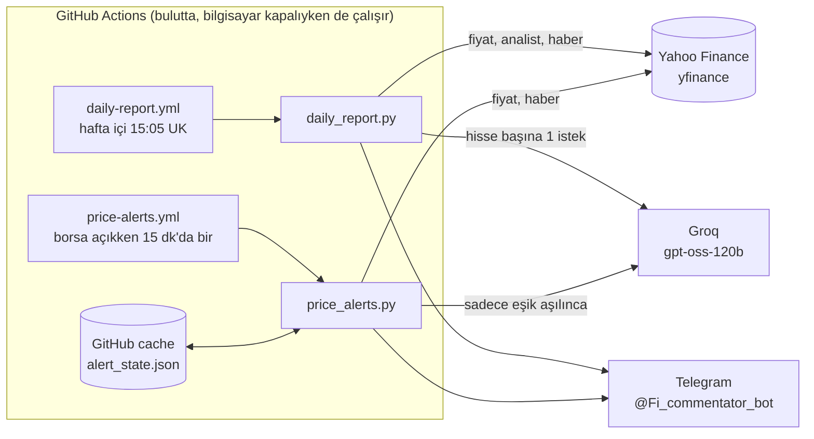

# Proje Günlüğü — Financial AI Analyst

Bu dosya sistemin nasıl çalıştığını ve bugüne kadar yapılan her şeyi tutar. Her adımdan sonra güncellenir.

## 1. Sistem ne yapıyor?

- **Günlük rapor:** Hafta içi 15:05'te (İngiltere saati) izleme listesindeki her hisse için fiyat, günlük değişim, analist görüşü, kısa yorum ve kaynaklı haberler Telegram'a gelir.
- **Fiyat uyarıları:** ABD borsası açıkken 15 dakikada bir fiyatlar kontrol edilir. Bir hisse gün içinde %3'ü (sonra %6, %9...) geçerse, olası sebebi ve haberleriyle birlikte Telegram'a uyarı gelir.
- **Sohbet arayüzü (isteğe bağlı, bilgisayarda):** `playground.py` çalıştırılıp os.agno.com üzerinden ajanlarla sohbet edilebilir.

İzleme listesi: **NVDA, AAPL, MSFT, TSLA** — `daily_report.py` içindeki `WATCHLIST`. Uyarılar da aynı listeyi kullanır.

## 2. Akış



**Temel ilke:** Rakamlar ve haber linkleri her zaman doğrudan yfinance'ten (kodla) gelir. Model sadece haberlerden en ilgili olanları seçer ve kısa bir yorum yazar. Böylece model rakam veya link uyduramaz.

**Rapor akışı:** yfinance'ten fiyat, analist ve 8 aday haber çekilir → model en ilgili 3 haberi seçip yorum yazar (sabit format: `output_schema`) → rapor `reports/` klasörüne kaydedilir → Telegram'a her hisse ayrı mesaj olarak gönderilir.

**Uyarı akışı:** Piyasa açık mı? (değilse atla) → günlük değişim yeni bir %3 basamağını geçti mi? (kodla, 0 token) → geçtiyse model haberlerden sebebi açıklar → Telegram → gönderilen basamak GitHub cache'e kaydedilir, aynı uyarı o gün tekrar gelmez.

## 3. Zamanlama

| Otomasyon | Ne zaman | Saat dilimi | İngiltere saatiyle |
|---|---|---|---|
| Günlük rapor | Hafta içi 15:05 | Europe/London | 15:05 |
| Fiyat uyarıları | Hafta içi 09:30–15:45, 15 dk'da bir | America/New_York | Normalde 14:30–20:45 (26 Ekim–1 Kasım haftası 13:30–19:45) |

- Yaz/kış saati geçişlerini GitHub kendisi halleder (`timezone` ayarı).
- Uyarılar borsa saatine bağlı olduğu için açılışta sert bir hareket olursa uyarı 15:05 raporundan **önce** gelebilir. *Karar (24.10): şimdilik böyle kalacak, gerekirse değişecek.*
- GitHub zamanlanmış işleri birkaç dakika (bazen 5–30 dk) geciktirebilir.

## 4. Dosyalar

| Dosya | Görevi |
|---|---|
| `daily_report.py` | Günlük raporu üretir, kaydeder, Telegram'a gönderir |
| `price_alerts.py` | Fiyatları kontrol eder, gerekirse uyarı gönderir |
| `playground.py` | Ajanları os.agno.com arayüzüne açan yerel sunucu (AgentOS) |
| `financial_agent.py` | Terminalde çalışan çoklu ajan (ekip) örneği — bkz. Bilinen sorunlar |
| `.github/workflows/daily-report.yml` | Günlük raporun zamanlaması |
| `.github/workflows/price-alerts.yml` | Fiyat uyarılarının zamanlaması |
| `requirements.txt` | Python paketleri |
| `.gitignore` | `.env`, `venv/`, `reports/`, `alert_state.json` GitHub'a yüklenmez |
| `.env` *(sadece bilgisayarda)* | API anahtarları |
| `venv/etc/conda/activate.d/zz_gitbash_fix.sh` *(sadece bilgisayarda)* | Git Bash için SSL ve UTF-8 düzeltmesi |

## 5. Hesaplar ve anahtarlar

| Ad | Nerede | Ne için |
|---|---|---|
| `GROQ_API_KEY` | `.env` + GitHub secret | Yapay zekâ modeli (Groq, ücretsiz plan) |
| `TELEGRAM_TOKEN` | `.env` + GitHub secret | Bot: @Fi_commentator_bot |
| `TELEGRAM_CHAT_ID` | `.env` + GitHub secret | Mesajların gideceği sohbet |
| `PHI_API_KEY` | `.env` | Artık kullanılmıyor (phidata kapandı) |

GitHub reposu: https://github.com/CanKocyigitoglu/Financial-AI-Analyst (public). Secret'lar: Settings → Secrets and variables → Actions.

## 6. Çalıştırma

Bilgisayarda (Git Bash, proje klasöründe):

```bash
conda activate ./venv
python daily_report.py     # raporu üret ve Telegram'a gönder
python price_alerts.py     # fiyatları şimdi kontrol et
python playground.py       # sonra os.agno.com → http://localhost:7777
```

Bulutta elle çalıştırma: GitHub → Actions → workflow'u seç → "Run workflow".

## 7. Maliyet ve limitler

- **Groq ücretsiz plan:** dakikada 30 istek, günde 1.000 istek, dakikada 8.000 token, günde 200.000 token. Ücret yok; limit aşılırsa istek reddedilir.
- **Ölçülen kullanım:** rapor hisse başına ~1.000 token (4 hisse ≈ 4.000 token/gün). Uyarı kontrolü 0 token; uyarı gönderildiğinde ~1.000 token.
- **GitHub Actions:** public repoda ücretsiz.
- **Ücretli Groq planına geçilirse:** milyon giriş tokenı 0,15 $, milyon çıkış tokenı 0,60 $.

## 8. Tasarım kararları

| Tarih | Karar | Neden |
|---|---|---|
| 23.10 | phidata → Agno 3.x (`Playground` → `AgentOS`) | phidata kapandı; os.agno.com eski sunucuyla konuşamıyordu |
| 23.10 | Model: `openai/gpt-oss-120b` | Eski Groq modeli kaldırılmış; Qwen denendi, araç çağrıları bozuk çıktı |
| 23.10 | DuckDuckGo → `WebSearchTools` (birden çok arama motoru) | DuckDuckGo sık sık "No results found" veriyordu |
| 24.10 | Rakam ve linkler koddan, model sadece seçer ve yorumlar | Ajan modunda model haber ve kaynak uyduruyordu |
| 24.10 | Haberler `yf.Search` ile | `Ticker.news` (ve Agno'nun haber aracı) boş liste dönüyor |
| 24.10 | Zamanlama GitHub Actions'ta | Bilgisayar kapalıyken de çalışsın |
| 24.10 | Telegram'a her hisse ayrı mesaj, HTML formatı | Telegram'ın 4.096 karakter sınırı |
| 24.10 | Rapor 15:05 UK (`Europe/London`) | Kullanıcının saati; saat başı GitHub'da yoğun |
| 24.10 | Uyarılar `America/New_York` saatine bağlı | Borsa saatleri New York'a göre |
| 24.10 | Uyarı kontrolü kodla, model sadece eşik aşılınca | Token harcamamak |
| 24.10 | Gönderilen uyarılar GitHub cache'te | Repoya otomatik commit gerekmesin |

## 9. Yapılanlar (tarih sırasıyla)

### 22 Ekim — Ortam sorunları
- `conda activate venv/` çalışmıyordu: conda, PowerShell/Git Bash için tanıtılmamıştı. Çözüm: `~/.bashrc` dosyasına conda hook satırı.
- `python playground.py` → "No such file or directory": conda'nın OpenSSL betiği Git Bash'te `SSL_CERT_FILE`'ı var olmayan bir yola ayarlıyordu. Çözüm: `zz_gitbash_fix.sh` (doğru SSL yolu + `PYTHONUTF8=1`; UTF-8 olmadan Türkçe/özel karakterler terminalde çökme yapıyordu).

### 23 Ekim — phidata'dan Agno'ya geçiş
- os.agno.com bağlanamıyordu (her istek 400): phidata kapanmış, yeni arayüz farklı bir API bekliyor.
- `playground.py` ve `financial_agent.py` Agno 3.1.9'a taşındı; model ve arama aracı değiştirildi.
- Bulgu: `financial_agent.py` ekip modu ücretsiz Groq limitine (dakikada 8K token) takılıyor ve eksik veriyi uydurma haberlerle dolduruyor.

### 24 Ekim — Maliyet analizi ve yol haritası
- Sorgu başına token ölçüldü; ücretsiz plan limitleri doğrulandı.
- 6 adımlık yol haritası belirlendi (aşağıda).

### 24 Ekim — Adım 1: Günlük rapor
- `daily_report.py` yazıldı. Test: 3 hisse 11 saniyede, ~1.000 token/hisse, tüm haber linkleri açılıyor.
- Bulgu: yfinance'in `Ticker.news` alanı artık boş dönüyor; playground'daki finans ajanının "son haberler" cevapları büyük ihtimalle uydurmaydı.

### 24 Ekim — Adım 2–3: Telegram ve GitHub Actions
- Telegram botu bağlandı, rapor her hisse ayrı mesaj olarak gidiyor.
- GitHub reposu oluşturuldu, secret'lar eklendi, workflow kuruldu. İlk bulut çalıştırması başarılı (47 sn), mesajlar geldi.
- Düzeltme: saat yanlışlıkla Türkiye saatine göre ayarlanmıştı → İngiltere saati, 15:05.

### 24 Ekim — Adım 4: Fiyat uyarıları
- `price_alerts.py` ve `price-alerts.yml` eklendi. Testler: 12 senaryoluk uyarı mantığı testi, piyasa kapalıyken atlama, Telegram'a deneme uyarısı.
- Hata düzeltmesi: rapordaki günlük değişim, gece seansını da içeren yanlış "önceki kapanış" ile hesaplanıyordu (örn. TSLA -0,63% yerine -0,30%). Artık Yahoo'nun resmi değerleriyle aynı.

## 10. Bilinen sorunlar ve açık işler

- `playground.py` finans ajanının haber aracı boş veri alıyor → model haber uydurabilir. Haber için şimdilik web ajanını kullan. *(Adım 6'da düzeltilecek.)*
- `financial_agent.py` ekip modu ücretsiz Groq limitine takılıyor; çıktısına güvenme.
- Uyarılardaki "olası sebep" sadece haber başlıklarına dayanıyor.
- GitHub zamanlanmış işleri gecikebilir, nadiren atlanabilir.
- Public repoda 60 gün hiç değişiklik olmazsa GitHub zamanlamayı durdurur (tek tıkla tekrar açılır).
- yfinance resmi olmayan bir Yahoo kütüphanesi; Yahoo değişiklik yaparsa bozulabilir.

## 11. Yol haritası

| Adım | Konu | Durum |
|---|---|---|
| 1 | Sabit formatlı günlük rapor | ✅ |
| 2 | Zamanlama (GitHub Actions) | ✅ |
| 3 | Telegram'a teslimat | ✅ |
| 4 | Akıllı fiyat uyarıları | ✅ |
| 5 | Hafıza: raporları saklama, "dünden bu yana ne değişti?" | ⏭ Sıradaki |
| 6 | Güvenilirlik: uydurmayı engelleme | Kısmen (rapor ve uyarılar zaten koddan veri kullanıyor; playground kaldı) |
